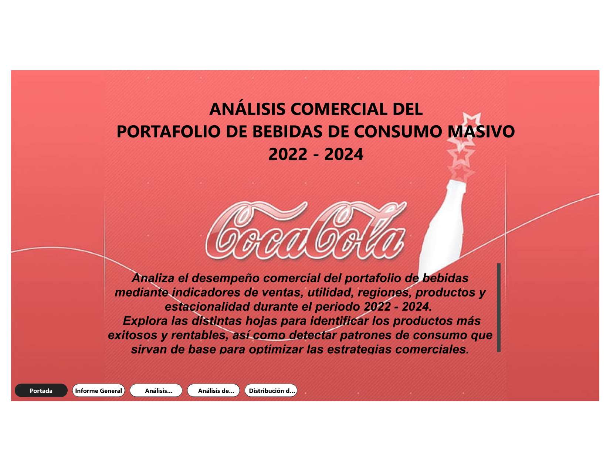

[readme.md](https://github.com/user-attachments/files/34955108/readme.md)
# Análisis Comercial del Portafolio de Bebidas

Español | [English](README.en.md)

Proyecto de **Data Analytics & Business Intelligence** enfocado en el sector de consumo masivo. El objetivo es analizar el desempeño del portafolio de bebidas, identificar oportunidades de crecimiento, evaluar el comportamiento del consumidor y optimizar la planificación comercial mediante el análisis de datos históricos.



## Problema de negocio

Una empresa del sector de bebidas de consumo masivo necesita comprender a profundidad el desempeño comercial de su portafolio. Existe la necesidad de tomar decisiones basadas en datos sobre qué productos impulsan el volumen versus cuáles impulsan la rentabilidad, y cómo se distribuye esta demanda geográficamente y por temporada.

**Pregunta central:** ¿Cómo transformar la información histórica de ventas en conocimiento estratégico que permita optimizar la oferta de productos, enfocar los esfuerzos de marketing y mejorar los márgenes de utilidad?

## Resultados clave

| Indicador | Valor |
|---|---|
| Concentración geográfica (West y South) | **70 %** de la facturación |
| Formatos preferidos (500 ml y 600 ml) | **87.37 %** del volumen vendido |
| Estacionalidad pico (Verano) | **28 %** de la facturación anual |
| Penetración de bebidas con edulcorante | **92.18 %** del volumen total |

## Principales hallazgos

- **Concentración Regional:** Las regiones *West* y *South* concentraron, en promedio, el 70% de la facturación durante el periodo analizado.
- **Liderazgo de Formatos:** Los envases de 500 ml (57.39%) y 600 ml (29.98%) representaron el 87.37% del volumen vendido, consolidándose como las opciones de mayor demanda.
- **Fuerte Estacionalidad:** La temporada de verano registró el mayor desempeño comercial, concentrando el 28% de la facturación anual del último periodo evaluado.
- **Volumen vs. Rentabilidad:** *Refresco Cola* y *Refresco Frutal* lideraron el volumen total de unidades vendidas. Sin embargo, *Refresco Cítrico* (39.18%) y *Té Frío* (37.44%) obtuvieron los mayores márgenes de utilidad, evidenciando que los productos más vendidos no siempre son los más rentables.
- **Preferencia por Edulcorantes:** El 92.18% de las unidades vendidas correspondió a bebidas con edulcorante. Esta categoría no solo lideró el volumen, sino que también presentó una mayor facturación y un margen promedio superior frente a las alternativas sin edulcorante.

## Recomendaciones

1. **Estrategias de Rentabilidad:** Diseñar campañas e incentivos dirigidos a aumentar la rotación de *Refresco Cítrico* y *Té Frío*, capitalizando sus altos márgenes de utilidad para empujar la rentabilidad global del portafolio.
2. **Garantizar Abastecimiento:** Alinear la planificación de producción e inventario de los formatos de 500 ml y 600 ml con edulcorante de cara a la temporada de verano para evitar quiebres de stock en el periodo de máxima demanda.
3. **Focalización Comercial:** Concentrar los recursos logísticos y de marketing primarios en las regiones *West* y *South*, buscando consolidar el 70% del ingreso actual, mientras se auditan las barreras de entrada en las regiones de menor desempeño.

## Dashboard

| Vista General Comercial | Análisis de Rentabilidad y Detalles (Tooltip)|
|---|---|
| **[Dashboard - Portada](/img/bebidas_page-0001.jpg)** | **[Dashboard - Informe General](/img/bebidas_page-0002.jpg)**, **[Dashboard - Análisis Comercial](/img/bebidas_page-0003.jpg)**, **[Dashboard - Análisis de producto](/img/bebidas_page-0004.jpg)**, **[Dashboard - Distribución de mercado](/img/bebidas_page-0005.jpg)**, **[Dashboard - Tooltip](/img/bebidas_page-0006.jpg)** |

## Solución técnica

- **Procesamiento de Datos (ETL):** Limpieza, transformación y conexión de datos históricos mediante **Power Query**.
- **Modelamiento de Datos:** Diseño de un modelo dimensional en estrella (*Star Schema*) para optimizar el rendimiento analítico.
- **Desarrollo Analítico:** Creación de indicadores dinámicos y métricas de negocio utilizando expresiones **DAX**.
- **Visualización:** Construcción de un reporte interactivo en **Power BI** centrado en la usabilidad de negocio.

## Estructura del repositorio

```
├── README.md                                          # Este documento
├── README.en.md                                       # Versión en inglés
├── docs/proyecto1/                                    # Documentación y reportes
│   └── Proyecto1.pdf                                  # Informe completo del análisis
├── data/Dataset del Análisis comercial del portafolio de bebidas/ # Datos fuente
└── img/                                               # Capturas del dashboard
    ├── bebidas_page-0001.jpg
    ├── bebidas_page-0002.jpg
    └── bebidas_page-0003.jpg
```

**[Ver informe completo (PDF)](/docs/Proyecto1.pdf)**

## Autor

**Sergio Aguilar Dinis** – Data Analyst | Business Intelligence
[LinkedIn](https://www.linkedin.com/in/sergio-aguilar-dinis-4766b858) · [Portafolio](https://fancy-coyote-67e.notion.site/PORTFOLIO-ES-b44f7f51a593839abe7b0196b748def2)
